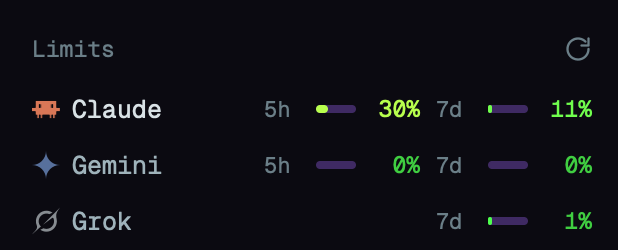

# AI Limits

A mod for the [Herdr](https://herdr.dev) desktop app: a **Limits** panel under the Agents list
that shows how much of each AI subscription you have used, one row per provider: Claude, Gemini
(through Antigravity) and Grok by default, or any provider
[quota-axi](https://github.com/kunchenguid/quota-axi) knows.



- **Two slots per row:** the short window (5 hours) and the long one (7 days, or 30 days for
  monthly plans). A provider without a 5-hour window leaves that slot empty.
- **Colour by usage:** one colour per 10% band, green to yellow to red.
- **Hover a row** for its plan, when each window resets and when it was last updated.
- **Running agents stand out:** rows of providers with an agent open in Herdr are drawn in full,
  the others dimmed.
- **Refresh:** at start, every 2 minutes, and from the ↻ button. `Err` in the header means
  quota-axi failed; hover it for the reason.

## Requirements

- The Herdr desktop app (`herdr-app`), macOS or Linux.
- [quota-axi](https://github.com/kunchenguid/quota-axi): `npm install -g quota-axi`.
  Run `quota-axi` once to see which providers it finds on your computer.
- Signed in with each provider's own tool, the way you already use it:
  - **Claude:** Claude Code.
  - **Gemini:** the Antigravity CLI (`agy`).
  - **Grok:** the Grok Build CLI (`grok login`). The row shows your SuperGrok weekly credits.

## Install

Tell the agent in your Herdr:

```text
Read ~/.config/herdr-app/AGENTS.md, then add this mod: https://github.com/bmichelin/herdr-ai-limits
```

Or by hand:

```sh
git clone https://github.com/bmichelin/herdr-ai-limits
cp -R herdr-ai-limits/mods/ai-limits ~/.config/herdr-app/mods/
herdr-app check ~/.config/herdr-app/mods/ai-limits
```

The mod doesn't dock itself. Herdr's own layouts are read-only, so clone yours first
(`herdr-app do layout.clone '{"name":"main","as":"my-layout"}'`), then add this block right after
the `agents` block in `~/.config/herdr-app/layouts/my-layout.json`:

```json
{ "id": "ai-limits", "type": "block", "content": { "mod": "ai-limits" }, "size": { "px": 140 } }
```

Give it about 41 px plus 28 px per row.

## Choose the providers

Pass quota-axi provider ids, in the order you want them, as the block's props:

```json
"content": { "mod": "ai-limits", "props": { "providers": ["claude", "codex", "agy", "grok"] } }
```

Names and icons are built in for `claude`, `codex`, `agy` (shown as Gemini), `grok`, `cursor`,
`copilot`, `kimi`, `opencode-go` and `muse`. Other ids get a generic row.

## What it reads and runs

Read this before installing.

- It runs `quota-axi --json --allow-keychain-prompt --provider <your providers>` every 2 minutes.
  The mod itself makes no network requests and reads no files.
- quota-axi reads the sign-ins already on your computer and calls each provider's own usage
  endpoint (Anthropic, Google through `agy`, xAI and so on), never a third-party relay. On macOS,
  `--allow-keychain-prompt` lets it read Claude Code's sign-in from the Keychain; macOS may ask
  once. See quota-axi's README for every source it reads.
- Some of these endpoints are not public APIs. When a provider changes one, its row shows `–` or
  `Err` until quota-axi is updated (`npm update -g quota-axi`).

## Credits

- Panel layout and colour bands adapted from
  [herdr-agent-limits](https://github.com/mchlkim/herdr-agent-limits) by Michael KIM (MIT).
- Quota data from [quota-axi](https://github.com/kunchenguid/quota-axi) by kunchenguid (MIT).
- Icons are the ones Herdr ships in `~/.config/herdr-app/icons`.

## License

MIT. See [LICENSE](LICENSE).
