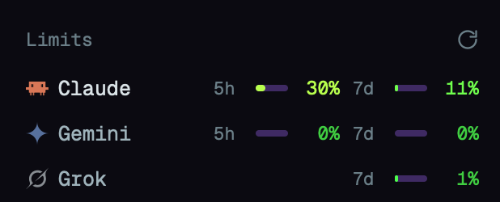

# AI Limits

A sidebar panel for the Herdr desktop app that shows plan usage for each AI subscription on this
computer, one row per provider, with a short (5-hour) and a long (7-day or 30-day) window each.

## What you see

- A block under the Agents list, on the sidebar's `chrome` background with a 1 px top border in
  `border`. Text size 12.5 px.
- Header, 41 px tall, 16 px side padding: `Limits` in 11.5 px medium `dim` on the left. On the
  right, a red `Err` (11 px semibold, `blocked`, tooltip with the error) when the last fetch
  failed, and a 14 px refresh icon in `dim` (`accent` while fetching, `foreground` on hover).
- One row per provider, 28 px tall, 8 px side padding, 8 px radius, `hover` background:
  - a 14 px icon from Herdr's shipped `icons/<name>.svg`. Full-colour icons use `image()`;
    one-colour icons (Gemini, Grok, Cursor, Copilot, OpenCode, Muse, the generic `agent`) use
    `svg()` tinted with `foreground`, or `#8ab4f8` for Gemini, so they show on dark themes;
  - the provider name, truncated, `foreground` when an agent of that provider is open in Herdr,
    `muted` otherwise; the icon at 60% opacity when none is open;
  - two 78 px slots: the window label (`5h`, `7d`, `30d`; 11 px `dim`, 22 px wide), a 20 x 4 px
    bar on `border` filled to the percentage used, and the percentage (11.5 px semibold, 28 px,
    right aligned). Bar and percentage share a colour from a stepped gradient, one hue per 10%
    band from green (0%) through yellow to red (100%). A missing window leaves its slot empty;
  - instead of the slots, a short `dim` note: `sign in` (provider needs a sign-in), `n/a`
    (unavailable), `–` (no data) or `…` (first fetch).
- Below 160 px of sidebar width, a rail: each icon over the highest percentage of its row.

## How it behaves

- Fetches at start, every 2 minutes and on a click of the refresh icon; a fetch in flight is not
  started twice.
- Tooltip on a row: name and plan, each window's reset time (`5h resets 21:00`,
  `7d resets Mon 02:00`, `30d resets 11/30 02:00`), the provider's error if any, and how long ago
  the data was fetched.
- A window whose reset time has passed shows 0% until the next fetch.
- No keys, no clicks on rows, no shared state.

## Built from

- `mods/ai-limits/main.js`, a `View` with `place: none` and title `Limits`. Not docked by
  itself: the layout adds `{ "id": "ai-limits", "type": "block", "content": { "mod": "ai-limits" },
  "size": { "px": 140 } }` after the `agents` block.
- Props: `{ providers?: string[] }`, quota-axi provider ids in display order, default
  `["claude", "agy", "grok"]`. Ids are filtered to `[a-z0-9-]+`.
- `herdr` functions: `exec` (runs `quota-axi --json --allow-keychain-prompt --provider <ids>`,
  falling back to the login shell `$SHELL -lic` when PATH lacks it), `agents` (which providers
  are running), `theme`, `layout` (sidebar width).
- Data: quota-axi's JSON `providers[]` with `provider`, `plan`, `state.status`, `state.error` and
  `windows[]` (`id`, `kind`, `percentRemaining`, `resetsAt`, `windowSeconds`). Model-scoped
  windows are ignored. Known providers pick fixed window ids (Claude `five_hour`/`seven_day`,
  Codex `five_hour`/`weekly`, Antigravity `gemini_5h`/`gemini_weekly`); others take the first
  `session` window as short and the first other window as long.
- Art: `mods/ai-limits/refresh.svg`, a circular arrow, and Herdr's shipped provider icons.
